# E-commerce Funnel & Retention Analysis: Olist Marketplace

**Problem.** Olist, a Brazilian marketplace, has healthy order volume but mixed reviews and very few returning customers. This project finds where the experience breaks, defines the metrics the product team should own, and ranks what to fix first.

**Stack.** SQL (SQLite: CTEs, window functions, joins) · Python · Pandas · Matplotlib/Seaborn · scikit-learn · Power BI

---

## TL;DR: the recommendation

> **Late delivery is the strongest driver of bad reviews.** A late order gets 1–2 stars **62%** of the time vs **9%** on time, and one day late is enough to triple the rate. Lateness is concentrated in long-haul lanes out of São Paulo (**Rio de Janeiro is 13% of orders but 23% of late deliveries**) and in a small group of **55 sellers** whose late rate is ≥2× the platform's. The time is lost **in transit** (late orders spend 28 days with the carrier vs 8 for on-time ones), not at the seller's desk.
>
> **Fix first:** carrier performance and delivery promises on the SP→RJ and SP→North/Northeast lanes, then the 55 problem sellers. **Owner metric: on-time delivery rate** (today 93.2%), with 1-star rate as the guardrail.
>
> **Second fix, cheap and surprising:** orders from **multiple sellers get 1–2 stars 47% of the time even when "on time"**. They arrive as separate parcels and customers review a half-delivered order. Show split shipments clearly at checkout and track delivery per parcel.
>
> **Be honest about retention:** only **~2–3% of customers ever buy twice** and **1.3%** return within 90 days. Better delivery helps (customers whose first order got 5★ come back 42% more often than 1★ ones), but even happy customers rarely return. Retention is a separate problem that needs experiments, not just better logistics. See [What I would test](#what-i-would-test-to-improve-repeat-purchase).

---

## Data

[Olist Brazilian E-commerce Public Dataset](https://www.kaggle.com/datasets/olistbr/brazilian-ecommerce): ~99K orders (Sep 2016 – Oct 2018) across 9 linked tables.

```
customers ─┐                      ┌─ order_items ── products ── category_translation
           └── orders (order_id) ─┼─ payments            └── sellers ── geolocation (by zip prefix)
                                  └─ reviews
```

**Analysis window:** purchases **Jan 2017 – Aug 2018** (99,092 orders). 2016 has only a few hundred test-period orders, and orders from Sep–Oct 2018 hadn't finished their journey when the data was cut.

**The `customer_unique_id` gotcha.** `customer_id` is regenerated for *every order*, so counting customers by it gives exactly 1.00 orders per customer and 0% repeat, by construction. The person is `customer_unique_id` (96,096 people, 1.035 orders each). Every retention query here uses it ([`id_gotcha`](outputs/tables/id_gotcha.csv)).

Other cleaning choices (all in [`sql/00_views.sql`](sql/00_views.sql)):
- ~550 orders have more than one review → keep the latest answered one.
- Orders with several items/sellers → "primary" seller & category = the first item; the basket size is kept as a feature.
- **Late** = delivered on a later *calendar day* than the estimated delivery date.
- **Repeat purchase** = a second order on a *later day* (same-day split baskets don't count as "coming back").

---

## 1. Funnel: the order pipeline is not the problem

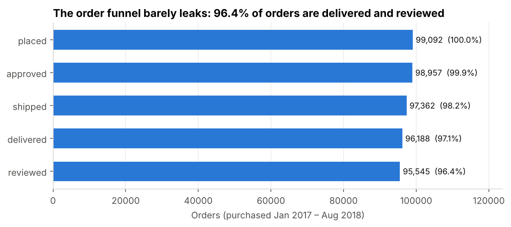

| Stage | Orders | % of previous | % of placed |
|---|---:|---:|---:|
| Placed | 99,092 | – | 100% |
| Approved | 98,957 | 99.9% | 99.9% |
| Shipped | 97,362 | 98.4% | 98.3% |
| Delivered | 96,188 | 98.8% | 97.1% |
| Reviewed | 95,545 | 99.3% | 96.4% |

The biggest single drop is **approved → shipped (1,595 orders)**, mostly orders that went *unavailable* (seller couldn't fulfil) or *canceled*. Of the ~2,900 orders that never arrive, 38% are stuck in `shipped` (lost in transit), 21% unavailable, 20% canceled. These are few, but they're the angriest customers: **78% of reviews on undelivered orders are 1–2 stars**, and they make up 15% of all low reviews.

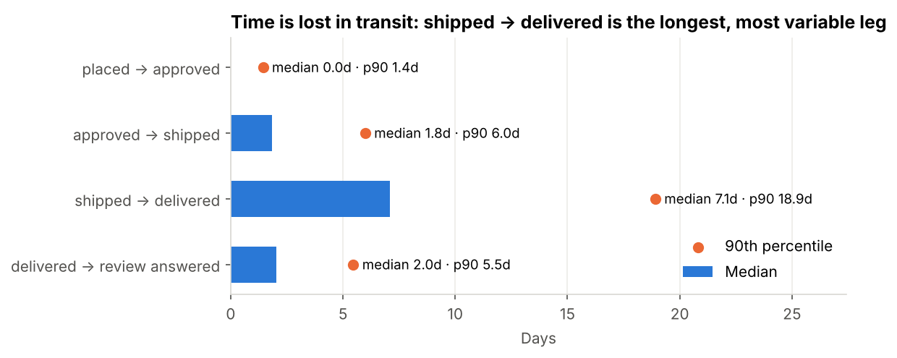

Time is the real leak. Median purchase → delivery is **10.2 days** (p90 = 23). Approval is near-instant, sellers hand over in ~1.8 days, and **transit is 7 days median with a long tail to 19 days (p90)**. That tail is where reviews die.

## 2. Cohort retention: repeat purchase is very low

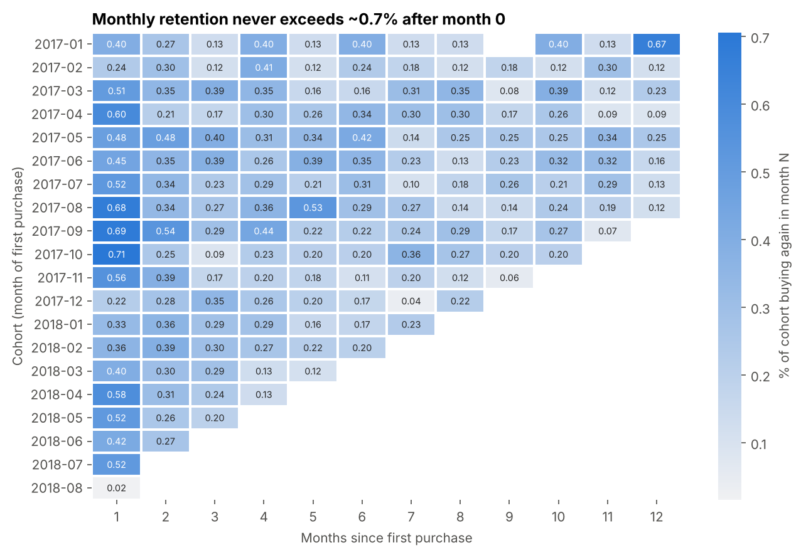

- Overall, **3.0%** of customers have 2+ orders, but only **2.2%** bought on 2+ different days, and **0.16%** on 3+ days.
- **90-day repeat rate is 1.3%** and has no upward trend across cohorts (0.9%–1.9%).
- No cohort keeps more than ~0.7% of its customers active in any later month.
- The Nov-2017 (Black Friday) cohort was the biggest ever and one of the least loyal (2.2% ever repeated vs ~3.5–4% for mid-2017 cohorts). Promotional buyers don't stick.

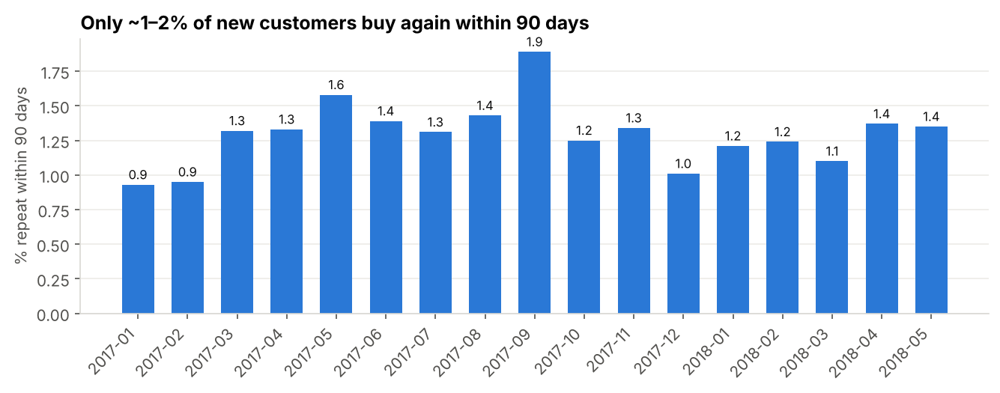

**First experience matters, but it isn't enough.** Repeat rate by the review a customer gave their *first* order ([`repeat_by_first_review`](outputs/tables/repeat_by_first_review.csv)):

| First-order review | 1★ | 2★ | 3★ | 4★ | 5★ |
|---|---:|---:|---:|---:|---:|
| Came back | 1.96% | 1.86% | 2.17% | 2.36% | 2.78% |

5★ customers return ~42% more often than 1★ ones. That's real, but 97% of delighted customers still never come back. Category matters at least as much: first buyers of fashion bags/accessories (4.4%), bed/bath/table (3.4%) and pet shop (3.2%) return most; electronics, office furniture and cool stuff (~1.6%) least ([`repeat_by_first_category`](outputs/tables/repeat_by_first_category.csv)). Many shoppers likely see the partner store, not Olist, so there's little brand pull to return.

## 3. Drivers: delivery delay vs review score

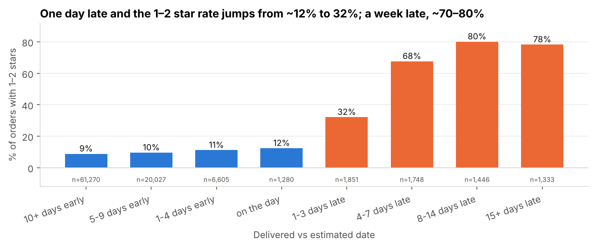

| Delivery | Orders | Avg review | 1★ rate | 1–2★ rate |
|---|---:|---:|---:|---:|
| On time | 89,182 | 4.29 | 6.6% | 9.3% |
| Late | 6,378 | 2.27 | 53.8% | 62.4% |

The relationship is a **cliff, not a slope**: arriving 10 days early vs on the day barely changes reviews (9% → 12% low), but 1–3 days late jumps to 32%, and 4+ days late to 68–80%. Customers judge against the *promise*, not the absolute speed.

It also shows up over time: monthly on-time rate and 1-star rate move together (**r = −0.87**). The two bad stretches, Black Friday Nov-2017 and Feb–Mar 2018, are both delivery failures:

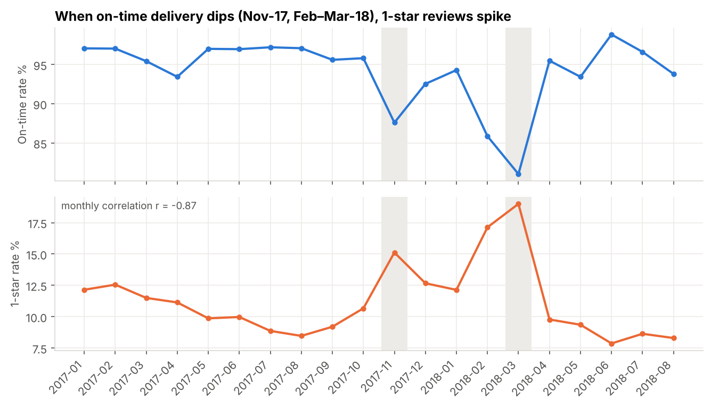

**Where is lateness concentrated?**

*Region.* 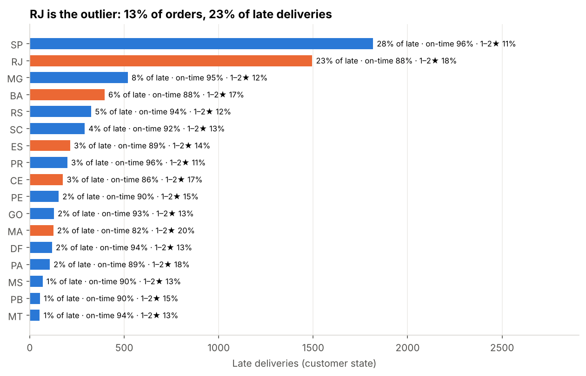
- **RJ: 12.8% of delivered orders, 22.9% of late ones** (on-time 88% vs 95.5% in SP). The single lane **SP → RJ** produces 1,152 late orders, 18% of all lateness from 8.5% of orders.
- North/Northeast states (MA 82%, CE 86%, BA 88% on-time) are 11% of orders but 20% of late deliveries, and have the highest low-review rates (17–20%).
- The estimated dates are already padded (the average promise is **24 days for a 12.5-day average delivery**), so lateness here is a carrier-reliability problem on specific lanes, not an over-optimistic promise everywhere.

*Seller.* Most late volume simply follows order volume (the top 98 sellers cause 50% of late orders but also handle 42% of orders). Isolating sellers whose late *rate* is ≥2× the platform's (min 30 orders): **55 sellers, 4.5% of orders, 11.5% of late deliveries**, with a 17% late rate. See [`drivers_by_seller`](outputs/tables/drivers_by_seller.csv) and [`problem_sellers`](outputs/tables/problem_sellers.csv). One high-volume seller averages 11.4 days to hand over to the carrier (platform: ~2.6).

*Seller vs carrier.* Late orders spend **5.5 days** with the seller before shipping (vs 2.6 on time) but **27.9 days** in transit (vs 8.0). Both matter; transit is ~85% of the gap.

*Category.* Category matters less than logistics. Office furniture (22% low reviews, 18% even when on time), bed/bath/table and furniture/decor are worst: bulky items that also suffer from quality/expectation gaps. ([`drivers_by_category`](outputs/tables/drivers_by_category.csv))

**The hidden second driver: split baskets.**

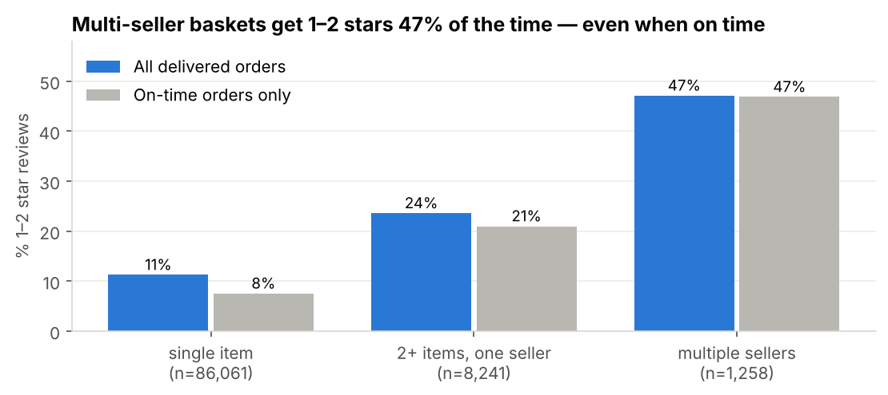

| Basket | Orders | 1–2★ | 1–2★ when on time |
|---|---:|---:|---:|
| Single item | 86,061 | 11.3% | 7.5% |
| 2+ items, one seller | 8,241 | 23.6% | 21.0% |
| Multiple sellers | 1,258 | 47.1% | 46.9% |

Multi-seller orders are shipped as separate parcels. The order is marked "delivered" when one arrives, the survey goes out, and the customer reviews an order that's missing items. Lateness doesn't explain this: the on-time rate is just as bad.

**How much of the 1–2★ problem does delivery explain?** Of all low reviews: 28% are on late orders, 15% on undelivered orders, and 57% on orders delivered on time (product quality, wrong item, split baskets). Delivery is the **strongest per-order driver** and the most fixable lever, but it's not the whole story.

## 4. Product metrics the team should own

Headline values for Jan 2017 – Aug 2018 ([`metrics_headline`](outputs/tables/metrics_headline.csv)); monthly series in [`metrics_monthly`](outputs/tables/metrics_monthly.csv).

| Metric | Value | Definition | What it's for | Owner |
|---|---:|---|---|---|
| **On-time delivery rate** ⭐ | **93.2%** | Delivered orders that arrive on or before the estimated date ÷ delivered orders | **North-star / owner metric.** The biggest controllable driver of reviews; it reacts within weeks to carrier and seller fixes. | Logistics / Marketplace ops PM |
| Avg delivery time | 12.5 days | Mean days from purchase to customer delivery (also track % within 14 days: 68.8%) | Shows whether "on-time" is improving because delivery got faster or just because promises got longer. Pair it with on-time rate so nobody games the estimate. | Logistics |
| 1-star review rate | 11.5% | Reviews with score 1 ÷ all reviews | **Guardrail / outcome metric.** Customer-felt quality; catches problems delivery metrics miss (wrong item, split baskets, quality). | CX / Trust & Safety |
| Average order value | R$160 | Mean (items + freight) of valid orders | Commercial health. Watch that delivery fixes (e.g. pricier shipping) don't push freight share up and AOV-adjusted conversion down. | Growth / Pricing |
| 90-day repeat purchase rate | 1.3% | New customers in month M with a second purchase on a later day within 90 days ÷ new customers in M | **Long-term health.** Measures whether the experience earns a second order. Slow and noisy, so read it by cohort, not week to week. | CRM / Retention PM |

*Why on-time rate is the owner metric:* it has the strongest link to the outcome we care about (r = −0.87 with 1-star rate month to month; 62% vs 9% low reviews per order), it's directly controllable (carrier choice, seller SLAs, promise logic), and it moves fast enough to manage weekly.

## 5. Model: which orders will get a 1–2 star review? (optional)

[`src/model.py`](src/model.py). Delivered orders with a review; **time-based split** (train: Jan 2017 – Apr 2018, 70K orders; test: May – Aug 2018, 25K orders, 10% low reviews). Seller history features (past late rate, past low-review rate, volume) are computed out-of-fold on train only, so nothing leaks from the test period.

| Features | Model | Test ROC-AUC | Test PR-AUC (base 0.10) |
|---|---|---:|---:|
| All | Logistic regression | 0.725 | 0.302 |
| All | Random forest | 0.722 | 0.331 |
| Without delivery-outcome features | Logistic regression | 0.657 | 0.215 |
| Without delivery-outcome features | Random forest | 0.657 | 0.211 |

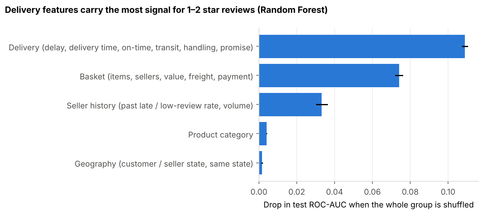

Individual delivery features (delay, delivery days, on-time flag, transit) are highly correlated and split the credit, so importance is measured by **shuffling each feature group together**:

1. **Delivery**: shuffling it drops ROC-AUC by **0.11**. The biggest group by far.
2. **Basket** (number of items / sellers, value, freight): 0.07, driven by `n_items` (the split-shipment effect).
3. **Seller history**: 0.03. Sellers with past low reviews keep getting them.
4. Category and geography add little once delivery is known; region matters *because* it causes lateness.

Logistic regression agrees: being on time cuts the odds of a 1–2★ review by ~43% per standard deviation, the strongest coefficient. Per-feature tables: [`model_rf_permutation_importance`](outputs/tables/model_rf_permutation_importance.csv), [`model_logit_coefficients`](outputs/tables/model_logit_coefficients.csv).

*Honest limits:* AUC ~0.72 is moderate. The 57% of low reviews on on-time orders are mostly about things not in the data (product quality, wrong item). The model is for explanation; as a CX alert, the RF at 0.5 flags 41% of future 1–2★ orders with 35% precision.

## 6. Dashboard

Power BI, 3 pages: **Overview** (KPI scorecard and monthly on-time vs 1-star trend), **Review Drivers** (delay buckets, late orders by state, basket type, seller table) and **Funnel & Retention** (order funnel, days between stages, cohort heatmap). Month, state and category slicers are synced across pages. File: [`powerbi/olist_funnel_retention.pbix`](powerbi/olist_funnel_retention.pbix). Build steps, relationships and DAX measures: [`powerbi/POWERBI_GUIDE.md`](powerbi/POWERBI_GUIDE.md).

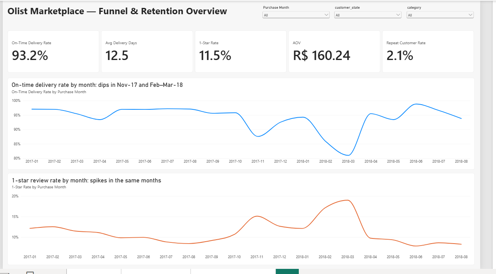
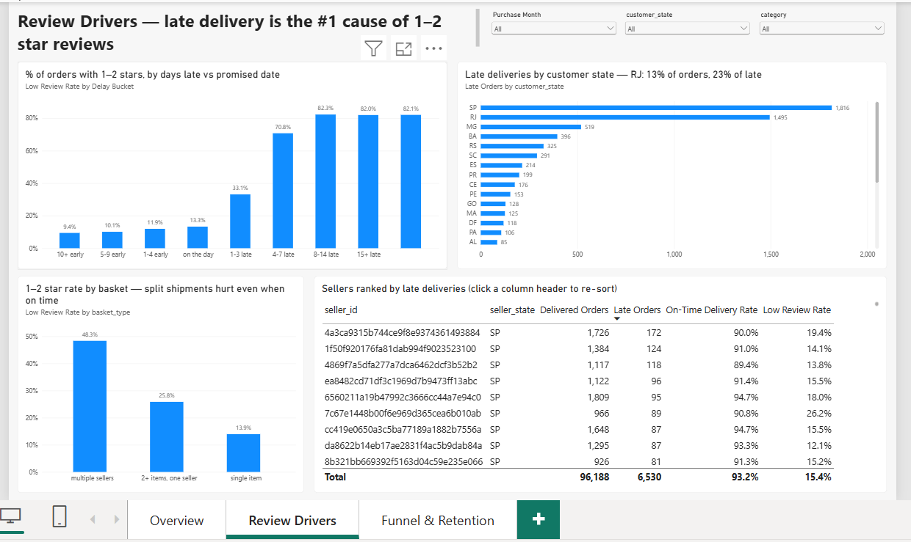
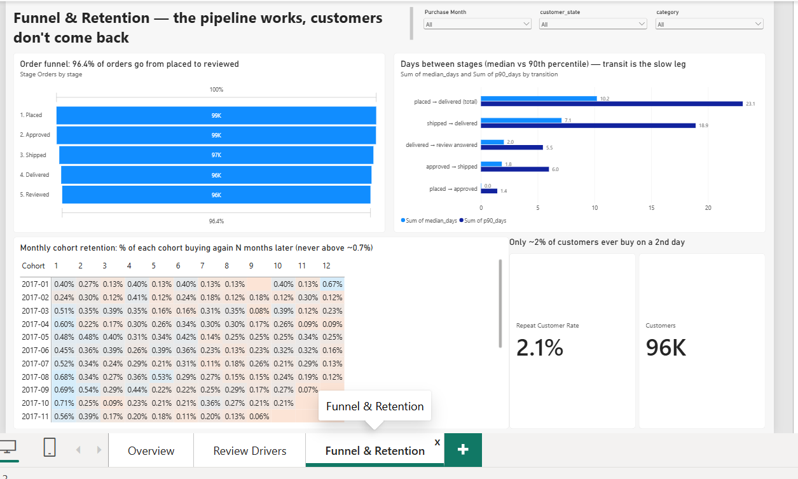

## 7. Recommendations: what to fix first

| # | Fix | Why (evidence) | Metric to watch |
|---|---|---|---|
| 1 | **Carrier performance on SP→RJ and SP→North/Northeast lanes**: renegotiate or add a second carrier on SP→RJ, use regional hubs for NE | SP→RJ alone = 18% of late orders from 8.5% of volume; NE states 82–88% on-time; transit is ~85% of the late-order gap | On-time rate by lane |
| 2 | **Seller SLA programme for the 55 problem sellers**: handling-time SLA (e.g. ship ≤ 3 days), ranking penalty, then delisting | 4.5% of orders → 11.5% of late orders; late orders wait 5.5 days at the seller vs 2.6 | Seller handling days, seller on-time rate |
| 3 | **Fix split-basket reviews**: send the review survey only after *all* parcels arrive, show "arrives in N parcels" at checkout | Multi-seller baskets: 47% low reviews even on time | 1–2★ rate for multi-item orders |
| 4 | **Peak-season playbook**: lengthen promises / add carrier capacity around Black Friday and Feb–Mar | On-time fell to 88% (Nov-17) and 81% (Mar-18); 1-star rate rose to 15–19% | Monthly on-time rate |
| 5 | **Recover failed orders**: proactive message + refund/voucher for orders past the estimated date or stuck in "shipped" | Undelivered orders: 78% low reviews; 15% of all low reviews | 1★ rate on late/undelivered orders |

**Expected impact (rough):** if late orders reviewed like on-time ones, the overall 1–2★ rate would drop by ~3.4 points (from 14.6% to ~11.2%). Getting RJ alone to SP's on-time rate would remove ~900 late orders over the period.

### What I would test to improve repeat purchase

Repeat purchase is very low (1.3% in 90 days) and delivery alone won't fix it. Each of these is an A/B test on new customers, measured by 90-day repeat rate (needs roughly 10K new customers per arm to detect a +0.5 pt lift on a 1.3% base at 80% power):

1. **Post-delivery second-order voucher** (e.g. 10% off within 60 days), sent only after an on-time delivery with 4–5★. Tests whether a nudge works when the experience was good.
2. **Category-aware cross-sell**: bed/bath and furniture buyers get related items (sheets, decor) 2–4 weeks after delivery, instead of a generic newsletter.
3. **Service recovery**: late-order customers get an apology + voucher; measure repeat vs a holdout. Tests whether rescuing a bad first experience pays.
4. **Replenishment reminders** for the categories that already get the most repeat buys (fashion accessories, bed/bath/table, pet shop: 3–4% vs 1.6% for electronics).
5. **Brand recognition**: "Olist" branding / account creation in the post-purchase flow, since many buyers think they bought from the partner store, not Olist.

---

## Repo structure

```
├── sql/
│   ├── 00_views.sql             # order-level fact view + review/item/payment aggregates
│   ├── 01_funnel.sql            # funnel stages, drop-off, time between stages
│   ├── 02_cohort_retention.sql  # cohorts, repeat rate, the customer_unique_id gotcha
│   ├── 03_drivers.sql           # delay vs review by seller, region, route, category, basket
│   └── 04_metrics.sql           # the 5 product metrics (monthly + headline)
├── src/
│   ├── load_data.py             # CSV -> SQLite + indexes + views
│   ├── run_sql.py               # runs every "-- name:" query -> outputs/tables/*.csv
│   ├── make_charts.py           # figures 01–08
│   ├── model.py                 # logistic regression + random forest, figures 09–11
│   └── export_powerbi.py        # star schema for Power BI -> powerbi/data/
├── outputs/
│   ├── tables/                  # every query result as CSV
│   └── figures/                 # charts used in this README
├── powerbi/
│   ├── olist_funnel_retention.pbix  # the dashboard
│   ├── POWERBI_GUIDE.md             # model, DAX measures, page layout
│   └── screenshots/                 # dashboard page images
├── run_all.sh
└── requirements.txt
```

## How to run

```bash
pip install -r requirements.txt

# 1. Get the data (Kaggle CLI, or download the zip manually from the Kaggle page)
kaggle datasets download -d olistbr/brazilian-ecommerce -p data/raw --unzip

# 2. Run everything (~2 minutes)
bash run_all.sh
```

Every number in this README comes from a CSV in `outputs/tables/`. The SQL is SQLite-flavoured; it runs on Postgres with small changes (`julianday(a) - julianday(b)` → `EXTRACT(EPOCH FROM a - b)/86400`, `strftime('%Y-%m', x)` → `to_char(x, 'YYYY-MM')`).

---
*Author: Nandika Bhardwaj · B.E Electronics and Computer Science , TCET · [GitHub](https://github.com/nbhardwaj2605-sudo)*
